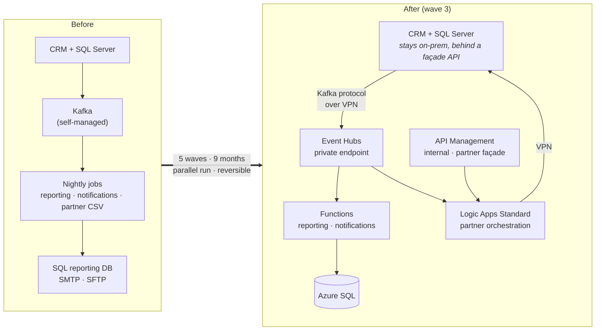

# On-prem → Azure integration migration — a reference architecture

[](https://github.com/patriksima/onprem-to-azure-integration/actions/workflows/infra-ci.yml)

A worked example of migrating a typical on-prem integration estate — **a CRM, a self-managed Kafka cluster, SQL Server, nightly jobs, partner CSV exchange** — to Azure, the way it actually happens in a mid-sized company: in waves, with parallel runs, with the system of record staying on-prem for now.

It is written the way I would run it as the architect: Cloud Adoption Framework as the structure of the documentation, Well-Architected Framework as the review of the design, and every box in the architecture backed by Bicep that passes linting and PSRule in CI.

The company, "Meridian", is fictional. The problems are not.

## What this repository demonstrates

| | Where |
|---|---|
| Turning business drivers into scope decisions — including what *not* to migrate | [docs/01-strategy.md](docs/01-strategy.md) |
| Assessment with measured numbers, dependency map, disposition per component (rehost / replatform / rebuild / retire / defer) | [docs/02-plan-assessment.md](docs/02-plan-assessment.md) |
| Consuming a platform landing zone: explicit assumptions, spoke design, identity, wave-0 gate | [docs/03-ready-landing-zone.md](docs/03-ready-landing-zone.md) |
| Target architecture with private networking, hybrid connectivity, error handling, idempotency, cost — and a **WAF review traceable to code** | [docs/04-target-architecture.md](docs/04-target-architecture.md) |
| Migration mechanics: Kafka → Event Hubs without losing events, shadow mode, database cutover after its writers, per-partner migration, rollback per wave | [docs/05-migration-plan.md](docs/05-migration-plan.md) |
| Running it: SLOs, alert catalogue, runbooks, governance, handover | [docs/06-operate.md](docs/06-operate.md) |
| Eight architecture decision records with the alternatives that lost | [docs/adr/](docs/adr/) |
| Infrastructure as code: spoke VNet, NSGs, private DNS, private endpoints, Event Hubs, Azure SQL, APIM (internal), Logic Apps Standard, Functions, Key Vault, monitoring, alerts — managed identity everywhere, no keys | [infra/](infra/) |
| CI that enforces the WAF without an Azure subscription: `bicep build`, `bicep lint`, PSRule for Azure | [.github/workflows/infra-ci.yml](.github/workflows/infra-ci.yml) |

## The migration in one picture



Target architecture in detail, with the network layout and the end-to-end data flow: [docs/04-target-architecture.md](docs/04-target-architecture.md).

## Waves at a glance

| Wave | What | The hard part |
|---|---|---|
| 0 | Landing zone verification, spoke, DNS, VPN, monitoring, pipelines | Getting DNS right from on-prem *before* anything depends on it |
| 1 | Event Hubs; MirrorMaker 2 bridge; new consumers in **shadow mode** next to old jobs; publisher flip | Switching a Kafka producer without losing or duplicating events |
| 2 | Reporting database → Azure SQL | Cutting over a database *after* its writer has already moved |
| 3 | Partner API via APIM; per-partner migration; old jobs retired | Partners move at their pace, not yours |
| 4 | Decommission Kafka, job server, SFTP | Actually switching things off |

## Repository layout

```
docs/                 CAF-structured documentation (strategy → plan → ready → adopt → operate)
docs/adr/             architecture decision records
infra/main.bicep      resource-group deployment, wires the modules
infra/modules/        network · network-security · private-dns · private-endpoint · monitoring · identity · keyvault
                      storage · eventhubs · sql · logicapp · functionapp · apim · apim-api · rbac · alerts · alerts-log
infra/params/         dev.bicepparam · prod.bicepparam
infra/apim/policies/  APIM policy for the partner API
infra/bicepconfig.json  linter rules
ps-rule.yaml          PSRule for Azure configuration (Well-Architected rule set)
.github/workflows/    infra-ci: build, lint, PSRule
```

## Validating locally

No subscription needed for any of this:

```bash
# Bicep CLI (https://github.com/Azure/bicep/releases)
bicep build infra/main.bicep
bicep build-params infra/params/dev.bicepparam
bicep lint infra/main.bicep

# PSRule for Azure (PowerShell)
Install-Module PSRule.Rules.Azure -Scope CurrentUser
Assert-PSRule -InputPath infra/ -Module PSRule.Rules.Azure -Format File
```

Deploying for real means a resource group in a corp landing zone and replacing the placeholder values in `infra/params/*.bicepparam` (Entra object IDs, hub VNet ID, firewall IP). APIM, Event Hubs, SQL and site names are globally unique in Azure, so a name collision means changing the `prefix` parameter. `az deployment group what-if` first; see [docs/03 §6](docs/03-ready-landing-zone.md#6-wave-0-gate--the-checklist-that-must-be-green-before-wave-1).

## Scope and honesty

- The infrastructure is complete for the integration layer. Application code (the two Functions and the partner workflows) is intentionally out of scope for this version; the contracts they implement are specified in [docs/04 §4–5](docs/04-target-architecture.md#4-data-flow--order-created-end-to-end).
- Prices are list prices at the time of writing and will drift. The *shape* of the cost argument ([docs/04 §8](docs/04-target-architecture.md#8-cost)) is the point.
- Some decisions are deliberately left open with a date and an owner ([ADR-003](docs/adr/ADR-003-apim-as-partner-facade.md)). Real architectures have those.

## Author

Patrik Šíma — enterprise and integration architect, Prague. [LinkedIn](https://www.linkedin.com/in/patriksima) · [Blog (Czech)](https://patriksima.github.io)

MIT licence. Use it, fork it, argue with it.
