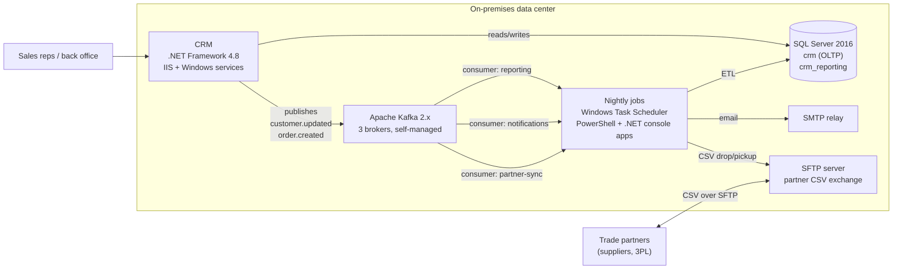

# 01 · Strategy — why we are migrating, and what "done" means

> CAF phase: **Strategy**. This document answers *why* before anyone touches *how*.
> Everything here is a fictional but realistic scenario built for this reference repository.

## 1. The company

**Meridian** is a mid-sized B2B distributor of industrial components. Roughly 400 employees, 2,000 active trade customers, 60 suppliers, operations in three EU countries. IT is a team of 14 people, of whom four build and run integrations.

The business runs on a home-grown CRM (sales, customers, orders) and a set of integrations around it. Nothing is exotic. That is the point: this is what most migrations actually look like.

## 2. Current state

Three integration flows matter:

| Flow | Trigger | Path today | Business impact if it fails |
|---|---|---|---|
| **Reporting** | `order.created`, `customer.updated` | Kafka → nightly ETL job → `crm_reporting` | Management dashboards stale; finance closes late |
| **Notifications** | `order.created` | Kafka → job → SMTP | Customers do not get order confirmations; support tickets |
| **Partner sync** | nightly 02:00 | Job reads `crm` → CSV → SFTP; partner drops stock/price CSV → job → `crm` | Wrong stock levels shown to customers; orders accepted that cannot be fulfilled |

## 3. Why move — the drivers, in order of weight

1. **Hardware and support end-of-life.** The data center lease ends in 14 months. SQL Server 2016 and Windows Server 2016 are out of mainstream support. Renewing on-prem means a capital decision the board does not want to make.
2. **Operational risk concentrated in people.** The Kafka cluster and the nightly jobs are understood by one engineer. There is no alerting; failures are discovered by the business the next morning.
3. **Partner pressure.** Two of the five largest partners have asked for a REST API instead of CSV over SFTP, one has set a deadline tied to their own platform migration.
4. **Cost of change.** Adding a new consumer to the current setup takes weeks: a new job, a new server account, a new firewall request, no shared observability.

What is **not** a driver: "cloud is cheaper". We make no such claim. The business case rests on avoided capex, reduced operational risk, and time-to-change.

## 4. Business outcomes and how they are measured

| Outcome | Metric | Today | Target after migration |
|---|---|---|---|
| Exit the data center on time | Workloads still on-prem at lease end | all | CRM application only (see §6) |
| Failures are detected by IT, not by the business | Mean time to detect an integration failure | next business day | < 15 minutes, alert to on-call |
| Partners can integrate via API | Partners on REST API | 0 | top 5 partners within 6 months of go-live |
| Faster change | Lead time for a new event consumer | weeks | days (template + pipeline) |
| Data freshness for reporting | Lag between order and dashboard | up to 24 h | < 15 min |

## 5. Constraints and non-negotiables

- **Data residency:** customer data stays in the EU. Primary region Sweden Central, paired region Germany West Central for backups.
- **Change windows:** production cutovers only Saturday 22:00–Sunday 06:00 CET. Order intake must not stop during business hours, ever.
- **Partners move at their own pace.** CSV/SFTP exchange must keep working until each partner has migrated. We cannot force a date.
- **No big bang.** Each wave must be independently reversible. If a wave fails, the business runs on the previous state on Monday morning.
- **Team capacity.** Four integration engineers, one DBA at 50 %, no dedicated network team (central IT provides the landing zone — see [03](03-ready-landing-zone.md)).
- **Identity:** Entra ID is already the identity provider for M365. Hybrid identity (Entra Connect) exists. New services must use managed identities; no new service accounts with passwords.

## 6. Scope decision: what moves, what stays, what waits

| Component | Decision | Reasoning (short — full reasoning in [ADRs](adr/)) |
|---|---|---|
| Kafka | **Migrate → Azure Event Hubs (Kafka protocol)** | Removes the self-managed cluster. Producers keep their Kafka client, only the bootstrap server and auth change. [ADR-001](adr/ADR-001-event-hubs-instead-of-kafka.md) |
| Event consumers (jobs) | **Rebuild → Azure Functions + Logic Apps Standard** | The jobs are the actual liability: no retries, no observability, batch where the business wants near-real-time. Rebuilding them is cheaper than hardening them. [ADR-002](adr/ADR-002-functions-and-logic-apps-split.md) |
| Partner integration | **Rebuild → API Management + Logic Apps; SFTP kept in parallel** | REST API is a business ask. SFTP runs until the last partner migrates. [ADR-003](adr/ADR-003-apim-as-partner-facade.md) |
| SQL Server (reporting DB) | **Migrate → Azure SQL Database** | First database to move: it has only one writer (the new reporting consumer) once the jobs are rebuilt, so cutover is simple. [ADR-004](adr/ADR-004-sql-migration-order.md) |
| SQL Server (CRM OLTP DB) | **Stays with the CRM, moves with the CRM** | Tightly coupled to the application. Moving the DB without the app adds latency to every CRM screen for no benefit. |
| CRM application | **Out of scope for this program; decision deferred** | The real options are SaaS CRM (Dynamics 365 / Salesforce) or a rebuild. Both are 12–18 month programs on their own. The integration layer is designed so that the CRM becomes *replaceable*: everything talks to it through events and an API facade, not direct DB access. [ADR-005](adr/ADR-005-crm-stays-on-prem.md) |
| SMTP relay | **Replace → Azure Communication Services Email** | Trivial, done inside the notifications rebuild. |

The CRM staying on-prem is not a failure of ambition — it is what makes the rest of the program deliverable within the lease deadline. It also means the target architecture is **hybrid by design**: private connectivity to on-prem is a first-class requirement, not an afterthought. That shapes the network design in [04](04-target-architecture.md).

## 7. Program shape

Five waves, each with its own go/no-go and rollback (details in [05](05-migration-plan.md)):

0. Landing zone readiness (central IT) and integration spoke
1. Event backbone: Event Hubs live, events mirrored, **new consumers run in parallel with old jobs**
2. Reporting database to Azure SQL
3. Partner API live; first partners migrated; old jobs decommissioned
4. Kafka cluster and SFTP decommissioned (SFTP only when the last partner has moved)

Target: waves 0–3 within 9 months, leaving a 5-month buffer before the lease ends for wave 4 and for the things that always go wrong.

## 8. What this document deliberately does not do

It does not pick SKUs, subnets or retention periods. Those are design decisions and live in [04](04-target-architecture.md) and the ADRs. Strategy documents that contain SKU names are a sign that the architecture was decided before the problem was understood.

---
Next: [02 · Plan — assessment, dependencies and waves](02-plan-assessment.md)
