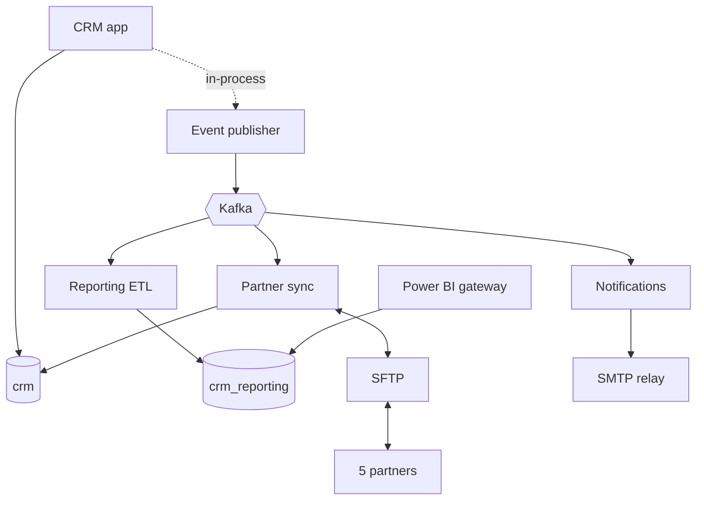
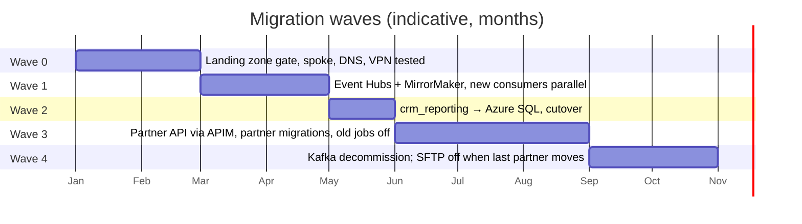

# 02 · Plan — assessment, dependencies, and migration waves

> CAF phase: **Plan**. Inventory what exists, understand what depends on what, pick a disposition per component, and sequence the work so that every step is reversible.

## 1. Assessment method

Three weeks, four people part-time. Not a tool-driven discovery (Azure Migrate is built for VM estates; this is an integration estate), but a structured manual one:

1. **Inventory** — every process, queue, topic, database, scheduled job, file share, service account, firewall rule that touches the three integration flows.
2. **Dependency mapping** — for each component: who calls it, what it calls, how (protocol, auth), how often, how much data.
3. **Interview the one engineer who knows Kafka** — recorded, transcribed, turned into runbooks before anything else happens. This is the single highest-value activity in the assessment: if he leaves mid-program, the program stops.
4. **Measure, don't assume** — one week of Kafka throughput per topic, job durations, SQL sizes, SFTP transfer volumes. Numbers below come from that week.

## 2. Inventory

### 2.1 Applications and services

| ID | Component | Technology | Hosts | Owner | Notes |
|---|---|---|---|---|---|
| A1 | CRM web application | .NET Framework 4.8, IIS | 2 × Windows Server 2016 (NLB) | App team | Out of scope, stays |
| A2 | CRM event publisher | Windows service, Confluent.Kafka 1.x | same hosts as A1 | App team | Publishes 2 topics, at-least-once, no idempotency keys in payload |
| A3 | Reporting ETL job | .NET console app, SQL bulk copy | 1 × job server | Integration team | Runs 01:00, consumes Kafka from last committed offset |
| A4 | Notifications job | PowerShell + .NET | job server | Integration team | Polls every 5 min; sends via SMTP; no retry on SMTP failure |
| A5 | Partner sync job | .NET console app | job server | Integration team | 02:00; 5 partners, 5 slightly different CSV formats |
| A6 | SFTP server | OpenSSH on Windows | 1 × server in DMZ | Infra | Per-partner accounts, password auth |

### 2.2 Data

| ID | Store | Technology | Size | Growth | Writers | Readers |
|---|---|---|---|---|---|---|
| D1 | `crm` (OLTP) | SQL Server 2016 Std, AG 2 nodes | 180 GB | 1.5 GB/month | A1, A5 (partner stock import) | A1, A5 |
| D2 | `crm_reporting` | SQL Server 2016 Std, same instance | 95 GB | 3 GB/month | A3 only | Power BI gateway, 12 analysts |
| D3 | Kafka topics | Kafka 2.6, 3 brokers, RF=3 | 7-day retention, ~40 GB | — | A2 | A3, A4, A5 |

### 2.3 Messaging — measured over one week

| Topic | Partitions | Avg msg/s | Peak msg/s | Avg size | Consumers (group) | Ordering requirement |
|---|---|---|---|---|---|---|
| `crm.customer-updated` | 6 | 0.4 | 12 | 2 KB | reporting, partner-sync | per customer |
| `crm.order-created` | 6 | 1.1 | 45 (Monday 08:00–10:00) | 6 KB | reporting, notifications, partner-sync | per order |

Peak of 45 msg/s × 6 KB ≈ 270 KB/s. This is **tiny**. The complexity of this estate is in coupling and operations, not in volume. Any sizing discussion that starts with throughput units is solving the wrong problem.

### 2.4 Integration flows — dependency map

Key observations:

- **A5 writes directly into the OLTP database.** Partner stock imports bypass the CRM's business logic. This is the most dangerous coupling in the estate and the reason partner sync cannot be "just moved" — it has to be re-fronted through a CRM API.
- **A3 is the only writer to `crm_reporting`.** This makes D2 the easiest database to migrate: once A3 is replaced by a cloud consumer, D2 has no on-prem writer at all.
- **No consumer is idempotent.** Kafka delivers at-least-once; the jobs rely on nightly batch windows to hide duplicates. Near-real-time consumers must handle duplicates explicitly.
- **Ordering** is per-key (customer id, order id), not global. Event Hubs partitions by key preserve this.

### 2.5 Non-functional baseline

| Aspect | Today |
|---|---|
| Monitoring | Windows event log, nobody reads it. One Zabbix check on broker process. |
| Alerting | None for integration flows |
| Backup | SQL nightly full + 15-min log; Kafka not backed up (retention is the "backup") |
| DR | None tested. AG failover tested once in 2022. |
| Security | Service accounts with passwords in config files; SFTP password auth; Kafka PLAINTEXT inside LAN |
| Secrets rotation | Never |
| Deployment | Manual copy to job server; no source of truth for config |

This table is the strongest argument for *rebuilding* the consumers rather than lifting them. There is nothing here worth preserving.

## 3. Non-functional requirements

Agreed with the business owners of the three flows and with IT security before any design work. Each has an ID so that design decisions ([04 §7](04-target-architecture.md#7-well-architected-framework-review)), alerts ([06 §3](06-operate.md#3-alert-catalogue)) and the post-migration evaluation ([07](07-evaluation.md)) can point at it. "Today" is the measured or honest baseline; where nobody knew, it says so.

| ID | Area | Requirement | Today | Verified by |
|---|---|---|---|---|
| NFR-01 | Availability | Order intake path (CRM → event → consumers) available 99.9 % monthly during business hours; no planned downtime 06:00–22:00 CET | unknown (not measured) | SLO dashboard, [06 §1](06-operate.md#1-what-healthy-means--slis-and-slos) |
| NFR-02 | Availability | Partner API 99.9 % monthly | n/a (no API) | APIM availability + Service Health |
| NFR-03 | Latency | Order visible in reporting within 15 min (p99), 5 min (p95) | up to 24 h | `ReportingLatencySeconds` |
| NFR-04 | Latency | Order confirmation email sent within 10 min for 99.5 % of orders | 5–10 min when the job works; hours when it does not | `NotificationsSent / OrdersCreated` |
| NFR-05 | Throughput | Sustain 10× measured peak (450 msg/s, ~3 MB/s) without redesign; 100× with configuration only | cluster never load-tested | Event Hubs TU headroom, partition count, load test in dev |
| NFR-06 | Recoverability | RPO ≤ 1 h, RTO ≤ 4 h for the integration layer (regional outage) | no DR | annual drill, [06 §5](06-operate.md#5-governance) |
| NFR-07 | Recoverability | Any single event replayable for 7 days; any day's events reconstructable for 1 year | 7 days (Kafka retention), no archive | Event Hubs retention + Capture |
| NFR-08 | Data integrity | Zero lost events across migration; duplicates never produce duplicate business effects | not measurable today | reconciliation query (wave 1 exit), idempotency tests |
| NFR-09 | Security | No public endpoints; no shared secrets between Azure services; secrets rotated ≤ 12 months; TLS 1.2+ | plaintext Kafka, passwords in config | PSRule in CI, Defender for Cloud, Key Vault expiry |
| NFR-10 | Security | Partner authentication per partner, revocable within 1 h | shared SFTP accounts | APIM subscription + client certificate |
| NFR-11 | Compliance | Customer data at rest and in transit stays in the EU; audit trail of partner API calls retained 90 days | EU on-prem; no audit trail | region policy, APIM gateway logs |
| NFR-12 | Observability | Any integration failure detected by IT within 15 min; any order traceable end-to-end by id in one query | next business day; no tracing | alert catalogue, `operation_Id` correlation |
| NFR-13 | Maintainability | New event consumer from template to dev in ≤ 2 days; all infrastructure reproducible from source | weeks; manual | pipeline, module reuse |
| NFR-14 | Operability | Tier-1 support resolves common failures with runbooks, without a developer | everything escalates to the integration team | hypercare metrics, [06 §6](06-operate.md#6-handover-criteria) |
| NFR-15 | Cost | Production run cost ≤ €4,500/month at current volumes; cost per 1,000 events known | not attributable | cost management, monthly review |
| NFR-16 | Migration | Every wave reversible within one change window; business operates on the previous state on Monday | — | rollback rehearsal per wave |

Two of these shaped the architecture more than any other: **NFR-08** (which forced idempotent consumers and the shadow-mode reconciliation) and **NFR-16** (which forced the wave order and the MirrorMaker bridge). The rest are met by reasonable defaults; those two are why the plan looks the way it does.

## 4. Disposition per component (the "R" decision)

CAF's migration options, applied honestly:

| Component | Rehost | Replatform | Refactor/Rebuild | Replace | Retire | **Decision** |
|---|---|---|---|---|---|---|
| A2 Event publisher | | ✅ change endpoint + auth | | | | **Replatform** — Confluent.Kafka client talks to Event Hubs over Kafka protocol with OAuth; code change is config + one auth callback |
| A3 Reporting ETL | | | ✅ | | | **Rebuild** as Function (Event Hubs trigger → Azure SQL), near-real-time instead of nightly |
| A4 Notifications | | | ✅ | ✅ SMTP → ACS Email | | **Rebuild** as Function; email via Azure Communication Services |
| A5 Partner sync | | | ✅ | | | **Rebuild** as Logic Apps Standard workflows: per-partner workflow, CRM access through an API, not the DB |
| A6 SFTP | | ✅ could be Azure Blob SFTP | | | ✅ eventually | **Keep on-prem, retire per partner** — moving SFTP to Azure is possible but spends effort on a thing we want to kill |
| D2 `crm_reporting` | | ✅ | | | | **Replatform** to Azure SQL Database (not Managed Instance: no cross-DB queries, no SQL Agent dependency once A3 is gone) |
| D3 Kafka | | ✅ | | | | **Replatform** to Event Hubs Standard with Kafka endpoint |
| D1 `crm` OLTP | | | | | | **Stays** (with A1) |
| A1 CRM | | | | ? | | **Deferred** — separate program |

A real assessment produces a few "we don't know yet" cells. Here it is A1. Writing "deferred" with a reason is better than pretending to a decision.

## 5. Risks identified during assessment

| # | Risk | Likelihood | Impact | Mitigation |
|---|---|---|---|---|
| R1 | Kafka engineer leaves | medium | program stops | Runbooks first; pair him with two others for wave 1; Event Hubs removes the dependency permanently |
| R2 | Duplicate events break near-real-time consumers | high | wrong reports, duplicate emails | Idempotency keyed on event id + consumer; design in [04 §5](04-target-architecture.md#5-error-handling-and-idempotency) |
| R3 | Partner sync rebuild exposes hidden business rules in the CSV handling | high | wrong stock levels | Parallel run with diff reports for ≥ 2 weeks per partner before cutover |
| R4 | Central IT landing zone not ready (VPN, DNS, policies) | medium | wave 1 slips | Wave 0 has a hard gate; spoke design assumes hub conventions; [03](03-ready-landing-zone.md) |
| R5 | Power BI gateway / analysts' queries depend on SQL Server features missing in Azure SQL | low–medium | reporting outage | Data Migration Assistant compatibility scan in wave 0; fix findings before wave 2 |
| R6 | Offset handling during Kafka → Event Hubs switch loses or replays events | medium | missing/duplicate records | Mirror topics with MirrorMaker 2; new consumers start from a known timestamp; reconciliation query in wave 1 exit criteria |
| R7 | Private DNS misconfiguration makes services unreachable from on-prem | high (it always is) | CRM publisher cannot reach Event Hubs | Conditional forwarders from on-prem DNS to Azure DNS Private Resolver — part of wave 0 gate; tested with a canary VM |

## 6. Waves — what goes together and why

The ordering principle: **move the thing with the fewest dependents first, and never move a producer and its consumers in the same wave.**

| Wave | Content | Depends on | Exit criteria | Rollback |
|---|---|---|---|---|
| **0** | Hub connectivity (VPN, firewall rules), spoke VNet, private DNS + resolver, policies, monitoring workspace, Key Vault, pipelines | central IT | Canary VM in spoke resolves and reaches on-prem CRM API and Kafka; on-prem resolves `privatelink` names; `what-if` clean on all templates | nothing in production touched |
| **1** | Event Hubs namespace; MirrorMaker 2 on-prem → Event Hubs; new Functions (reporting, notifications) consume from Event Hubs **in shadow mode** (reporting writes to a staging schema; notifications log instead of sending); then publisher switched to Event Hubs directly | 0 | 14 consecutive days: reconciliation Kafka vs Event Hubs event counts = 0 diff; shadow reporting matches `crm_reporting` within tolerance; alerting proven by chaos test | publisher config back to on-prem Kafka (one deployment); MirrorMaker stopped |
| **2** | `crm_reporting` → Azure SQL via transactional replication / DMS online; reporting Function switched to write production schema; old ETL job disabled; Power BI gateway repointed | 1 | Row counts and checksums match; analysts sign off; old job off for 7 days with no escalation | re-enable ETL job, repoint gateway; Azure SQL kept in sync for the window |
| **3** | APIM partner API live (internal-facing, exposed via hub firewall / Front Door per landing zone); Logic Apps partner workflows; CRM read/write API (thin façade on A1, built by app team); partners migrated one at a time; SFTP path kept per partner until each confirms | 1, CRM façade | Each partner: 2 weeks parallel run, zero unexplained diffs; old partner-sync job off | per partner: switch back to CSV path (still running) |
| **4** | Kafka cluster shut down; job server decommissioned; SFTP server retired once last partner migrated | 1–3 | 30 days without any traffic on old paths (measured) | restore from last known config — accepted as a real but low risk |

### Why not move SQL first?

It is tempting: databases are "just data". But `crm_reporting` has a writer (A3) that would then write across the VPN every night, and nothing improves for the business. Moving the event backbone first means the *new* reporting consumer is the only writer when the database moves — the database migration becomes a one-time copy plus a short sync, not a hybrid write path.

### Why not move everything in one weekend?

Because wave 1 exit criteria require 14 days of parallel run. There is no way to get confidence in event parity in a change window. Anyone proposing a one-weekend migration of this estate is proposing to find the problems in production.

---
Previous: [01 · Strategy](01-strategy.md) · Next: [03 · Ready — landing zone assumptions](03-ready-landing-zone.md)
