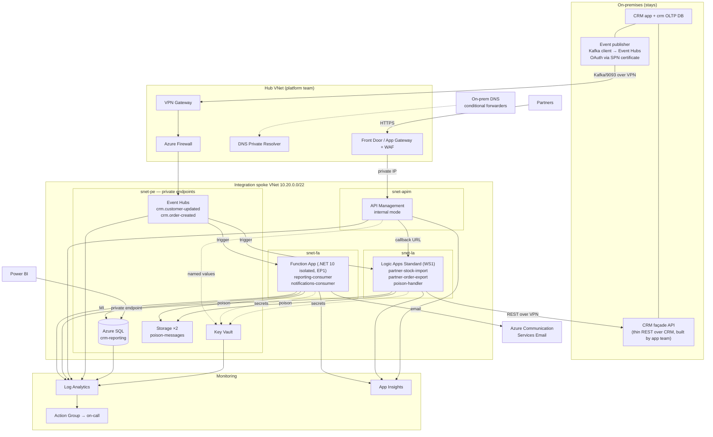
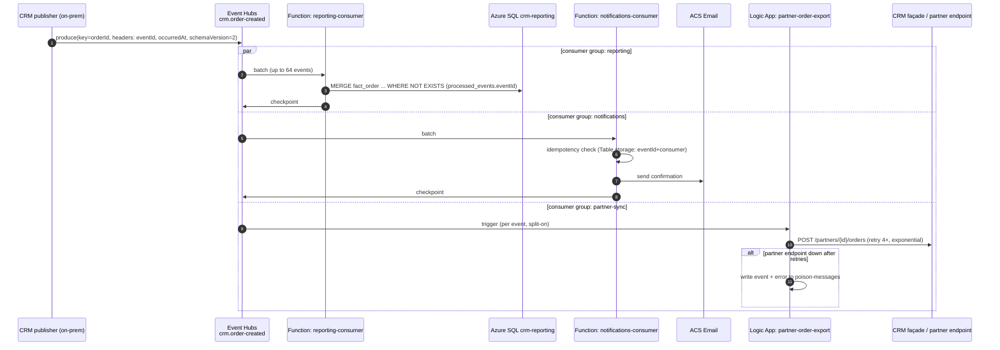

# 04 · Target architecture

> CAF phase: **Adopt** (design). Every box below exists in [`infra/`](../infra/) as Bicep. The Well-Architected review in §7 maps each pillar to concrete decisions in this design, not to generic advice.

## 1. End state (after wave 3)

## 2. Component decisions

| Component | Choice | SKU dev / prod | Why this and not the alternative |
|---|---|---|---|
| Event backbone | **Event Hubs Standard, Kafka endpoint** | Standard 1 TU auto-inflate to 4 / Standard 2 TU, zone-redundant | Kafka protocol compatibility means the on-prem publisher changes config, not code. Premium/Dedicated is unjustifiable at 270 KB/s. Service Bus was considered and rejected for this layer — see [ADR-001](adr/ADR-001-event-hubs-instead-of-kafka.md) and [ADR-006](adr/ADR-006-no-service-bus-in-wave-1.md). |
| Event consumers | **Azure Functions, .NET 10 isolated** | Elastic Premium EP1 / EP1, 1–3 instances | Event Hubs trigger with checkpointing, scale per partition, VNet integration (Consumption plan cannot do private endpoints). Logic Apps rejected for high-frequency per-event processing: cost per action and cold path. |
| Partner orchestration | **Logic Apps Standard** | WS1 / WS1 | Per-partner workflows with retries, run history visible to support staff, built-in connectors for SFTP (transition) and HTTP. Stateful runs give an audit trail per partner exchange that a Function would have to build. [ADR-002](adr/ADR-002-functions-and-logic-apps-split.md) |
| API façade for partners | **API Management, internal VNet** | Developer / Premium 1 unit | Subscription keys per partner, rate limits, versioning, one place to change the backend when the CRM is replaced. Developer tier in dev because it is the cheapest tier with VNet support; v2 tiers evaluated and parked ([ADR-003](adr/ADR-003-apim-as-partner-facade.md)). |
| Reporting database | **Azure SQL Database, General Purpose** | GP serverless 1 vCore / GP 2 vCore zone-redundant | Single database, no SQL Agent or cross-DB dependencies after the ETL job is retired. Managed Instance would cost 3× for features nobody uses. [ADR-004](adr/ADR-004-sql-migration-order.md) |
| Secrets | **Key Vault, RBAC mode** | Standard | Only for secrets that cannot be managed identity: ACS connection, partner API credentials, SPN certificate thumbprint reference. Everything Azure-to-Azure uses MI. |
| Observability | **Log Analytics + workspace-based App Insights** | 30-day / 90-day retention | One workspace for the workload; platform policy also ships resource logs to the central workspace. |
| Hybrid connectivity | **Platform VPN gateway via hub peering** | — | Spoke uses remote gateway; no gateway in the spoke. ExpressRoute is a platform decision; the design is indifferent. |
| Poison messages | **Blob container `poison-messages` + alert** | — | Event Hubs has no dead-letter queue. Consumers write undeliverable events with context to blob; a Logic App `poison-handler` notifies and supports replay. [§5](#5-error-handling-and-idempotency) |

## 3. Network and DNS

- All PaaS services have **public network access disabled** and a **private endpoint** in `snet-pe`.
- Logic Apps and Functions use **regional VNet integration** with `vnetRouteAllEnabled` so that *all* outbound traffic — including to Event Hubs and SQL — goes through the VNet, the route table, and the hub firewall.
- APIM runs in **internal mode**; its private IP is the backend of the platform's Front Door / App Gateway. It still carries a Standard public IP — stv2 VNet injection requires one for the management plane even when no API is reachable through it. Expect the question in review; the answer is in `apim.bicep`.
- **Private DNS zones** are workload-managed and linked to the spoke (see [03 §2 LZ-3](03-ready-landing-zone.md)). On-prem resolution works through conditional forwarders to the hub's DNS Private Resolver.
- Every subnet has an NSG (PSRule insists, and so should you — including `snet-pe`), `defaultOutboundAccess` is off, and 22/3389 are denied outbound everywhere. The NSG on `snet-apim` additionally carries the rules APIM needs to function (management endpoint 3443 from `ApiManagement` tag, 6390 from `AzureLoadBalancer`) — these are the rules people forget and then spend a day debugging a stuck deployment.
- The route table sends `0.0.0.0/0` to the firewall's private IP. The one exception APIM needs (management traffic must not be forced through the firewall without the `ApiManagement` service tag route) is handled by an explicit `ApiManagement → Internet` route on the APIM subnet.

## 4. Data flow — order created, end to end

Correlation: the publisher sets `traceparent` (W3C) in Kafka headers; the Functions host propagates it into App Insights; the Logic App copies it into the outgoing HTTP call. One `operation_Id` shows the order's journey across all three consumers.

## 5. Error handling and idempotency

Event Hubs is a log, not a queue. It does not retry, it does not dead-letter, and it will happily deliver the same event twice. The design accepts this rather than fighting it:

| Concern | Mechanism |
|---|---|
| **Duplicates** | Every event carries a producer-generated `eventId` (UUID). Each consumer keeps a `processed_events(eventId, consumer, processedAt)` record — in Azure SQL for the reporting consumer (same transaction as the write), in Table storage for notifications. Duplicate → skip, log at Information, metric `DuplicateEvents` incremented. |
| **Ordering** | Partition key = `orderId` / `customerId`. Event Hubs preserves order within a partition; the Functions host processes one partition sequentially per instance. Consumers never assume cross-key ordering. |
| **Transient failures** (SQL throttling, CRM API 503) | Functions: Polly-style retry in code (3 attempts, exponential, jitter) *before* letting the trigger retry; Event Hubs trigger retry policy `fixedDelay` as the second layer. Logic Apps: action retry policy, exponential, 4 attempts, 1 min initial. |
| **Poison events** (schema invalid, business rule violation, retries exhausted) | Write `{event, error, consumer, attempt, firstSeen}` to blob `poison-messages/{consumer}/{yyyy}/{MM}/{dd}/{eventId}.json`, **then checkpoint** so one bad event does not block the partition. Alert on any new blob (scheduled query on `StorageBlobLogs`). Logic App `poison-handler` posts to the support Teams channel with a replay button (HTTP trigger → re-publish to Event Hubs with a `replayOf` header). |
| **Consumer lag** | No native lag metric on Event Hubs; the alert compares `IncomingMessages` vs `OutgoingMessages` per consumer group over 15 min and also fires if a Function has had zero executions while incoming > 0. |
| **Checkpoint storage unavailable** | Host stops processing rather than reprocessing from the beginning — acceptable; alert on Function availability. |
| **Partial batch failure** | The reporting consumer processes a batch inside one SQL transaction; on failure it falls back to per-event processing so that one bad row isolates itself as poison rather than failing 63 good ones. |
| **Schema evolution** | `schemaVersion` header; consumers accept N and N-1; publisher never removes fields within a major version. Schema Registry (Event Hubs) is planned for wave 3, not needed for two topics. |

## 6. Security

- No public endpoints anywhere; Front Door + WAF in the hub is the only ingress, and only for the partner API.
- Managed identities + RBAC for every Azure-to-Azure call; local auth disabled on Event Hubs, Entra-only on SQL, shared keys disabled on storage. Verified by `PSRule.Rules.Azure` in CI.
- Partner authentication at APIM: subscription key **and** client certificate (mTLS) per partner; `validate-jwt` ready for partners who can do OAuth client credentials.
- Key Vault: RBAC authorization, purge protection, private endpoint, no access policies.
- TLS 1.2 minimum on everything; APIM disables TLS 1.0/1.1 and 3DES ciphers via `customProperties`.
- Secrets rotation: ACS and partner credentials have Key Vault expiry set; alert 30 days before. The on-prem SPN certificate is the documented exception (annual, manual, with a calendar entry and an owner).
- Defender for Cloud plans (platform policy): Storage, Key Vault, SQL, API Management — the partner API is onboarded to Defender for APIs explicitly (`Microsoft.Security/apiCollections` in `apim-api.bicep`).
- Azure SQL uses a customer-controlled maintenance window (`SQL_SwedenCentral_DB_2`, Fri–Sun 22:00–06:00) so platform maintenance lands inside the agreed change window rather than on a Monday morning.

## 7. Well-Architected Framework review

Format: pillar → the specific decisions in this design that serve it, the NFRs from [02 §3](02-plan-assessment.md#3-non-functional-requirements) they satisfy, and the trade-off accepted.

| Pillar | Decisions in this design | Trade-off accepted |
|---|---|---|
| **Reliability** (NFR-01, 02, 06, 07, 08, 16) | Zone-redundant Event Hubs and SQL in prod; EP1 with minimum 1 pre-warmed instance; consumers idempotent so retry is always safe; poison path checkpoints past bad events; each wave has a tested rollback; paired-region geo-backup for SQL (RPO 1 h) | No active-active region. RTO for a regional outage is "redeploy from Bicep to the paired region + restore SQL", estimated 4 h, accepted by the business for an integration layer whose source of truth (CRM) is on-prem anyway. |
| **Security** (NFR-09, 10, 11) | Private endpoints + disabled public access everywhere; MI/RBAC, no keys; APIM mTLS + subscription keys; Key Vault RBAC + purge protection; PSRule in CI blocks regressions; platform WAF | One SPN with certificate for the on-prem publisher. Developer-tier APIM in dev has no SLA and single instance — acceptable for dev. |
| **Cost Optimization** (NFR-15) | Serverless SQL in dev auto-pauses; Developer APIM in dev; Event Hubs Standard (not Premium) sized from measured throughput; EP1 smallest premium plan; 30-day retention in dev; dev environment torn down nightly by pipeline (`infra-destroy`) | EP1 and WS1 plans cost ~€150/month each even idle — the price of VNet integration. Consumption plans would be cheaper but cannot do private networking. |
| **Operational Excellence** (NFR-12, 13, 14) | Everything in Bicep — Azure Verified Modules for commodity resources, pinned ([ADR-009](adr/ADR-009-azure-verified-modules.md)); one pipeline per environment, `what-if` on PR; diagnostics on every resource; alert rules in code with runbook links; structured logging with `eventId`/`orderId` as custom dimensions; Logic App run history for support; wave exit criteria are measurable | Bicep has no state file, so drift detection is `what-if` on a schedule, not continuous. |
| **Performance Efficiency** (NFR-03, 04, 05) | Partition key design preserves ordering without global locks; batch processing in reporting consumer; Event Hubs auto-inflate; Function scale-out bounded by partition count (4) — documented so nobody "scales to 20 instances" and wonders why 16 idle | 4 partitions caps parallelism at 4 per consumer group. At 45 msg/s peak this is ~10× headroom. Partition count cannot be reduced later on Standard; chosen deliberately low. |

Each row in this table is traceable to a resource property in `infra/` or a line in the migration plan. A WAF review that cannot be traced to code is a slide, not a review.

The review is enforced, not just written: CI runs PSRule for Azure against the expanded templates. Where this design deliberately departs from a rule — single-unit APIM, the Logic App content-share key, no workspace replication — the exception is recorded with its reason in [`.ps-rule/suppressions.Rule.yaml`](../.ps-rule/suppressions.Rule.yaml) and shows up as a warning on every run, so it cannot quietly become permanent.

## 8. Cost

Indicative monthly list prices, Sweden Central, November 2026, no reservations. Numbers are rounded; the point is the shape, not the cents.

| Resource | Dev | Prod |
|---|---|---|
| API Management | Developer ≈ €45 | Premium 1 unit ≈ €2,600 |
| Logic Apps Standard WS1 | ≈ €160 | ≈ €160 (×1, scale-out on demand) |
| Function App EP1 | ≈ €150 | ≈ €150 (min 1) |
| Event Hubs Standard | ≈ €20 (1 TU) | ≈ €40 (2 TU) |
| Azure SQL | GP serverless, auto-pause ≈ €30 | GP 2 vCore zone-redundant ≈ €450 |
| Key Vault, Storage ×2, private endpoints ×10, DNS zones | ≈ €90 | ≈ €90 |
| Log Analytics + App Insights (≈ 5 GB/day prod) | ≈ €20 | ≈ €350 |
| **Total** | **≈ €515** | **≈ €3,840** |

Two observations an architect should make unprompted:

1. **APIM Premium is 68 % of the production bill.** It is there for the SLA and the VNet. If the platform team's Front Door can do the partner-facing throttling and the partner count stays at five, APIM **Standard v2** (≈ €650, VNet integration for outbound, private endpoint for inbound) is the first thing to re-evaluate before go-live. This is tracked as an open decision in [ADR-003](adr/ADR-003-apim-as-partner-facade.md).
2. **The on-prem comparison is not €3,840 vs €0.** It is €3,840 vs three physical servers, SQL Server Standard licences, one FTE-equivalent of Kafka care, and a data center lease. The business case in [01](01-strategy.md) is built on that, not on the Azure bill alone.

---
Previous: [03 · Ready](03-ready-landing-zone.md) · Next: [05 · Migration plan](05-migration-plan.md)
