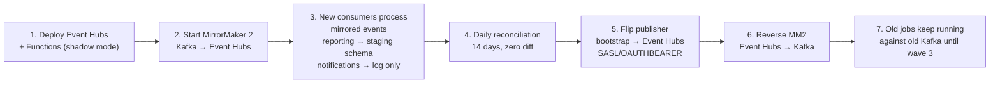

# 05 · Migration plan — waves, coexistence, cutover, rollback

> CAF phase: **Adopt** (migrate). This is the operational plan. The principle throughout: **nothing is switched off until its replacement has run in parallel long enough to be boring.**

## 1. Wave 0 — foundation (weeks 1–8)

Content: landing zone verification, spoke deployment, monitoring, pipelines, runbooks. No production traffic touched. Gate checklist in [03 §6](03-ready-landing-zone.md#6-wave-0-gate--the-checklist-that-must-be-green-before-wave-1).

The two activities that most often slip and therefore start on day one:

- **Firewall and DNS requests to central IT.** Lead time is measured in weeks. Raise them in week 1 with the exact table from [03 §2](03-ready-landing-zone.md).
- **Kafka runbooks.** Interview, write, review. If the Kafka engineer wins the lottery in week 6, wave 1 still happens.

## 2. Wave 1 — event backbone with parallel consumers (weeks 9–16)

### 2.1 The hard part: switching a Kafka producer without losing or duplicating events

Four options were considered:

| Option | How | Problem |
|---|---|---|
| A. Flip the publisher to Event Hubs at a quiet moment | Change bootstrap server, restart | Consumers on old Kafka stop receiving at the same instant; no parallel run possible; offsets do not carry over |
| B. Dual-write from the publisher | Publish to both | Requires code change in A2 and introduces the classic dual-write inconsistency (one succeeds, one fails) |
| **C. MirrorMaker 2 from Kafka to Event Hubs** | MM2 runs on-prem, replicates both topics to Event Hubs with the same keys | Replicated events arrive with a delay (seconds); MM2 is one more thing to run — but only for the duration of the wave |
| D. Event Hubs Capture / replay from Kafka retention | Backfill | Solves history, not the live switch |

**Chosen: C, then A.** MirrorMaker keeps Event Hubs populated while *new* consumers are validated against *old* ones for two weeks. Then the publisher is flipped (option A) at a quiet moment, MM2 is stopped, and the overlap is handled by idempotency.

### 2.2 Steps



Step 7 has a consequence that is easy to miss: after step 5 nothing publishes to on-prem Kafka any more, yet the old jobs still read from it. So step 6 is not "stop MM2" but **reverse it** — Event Hubs → on-prem Kafka. The old jobs keep working without knowing anything changed. The old jobs are retired in wave 3, after the *new* consumers have been in production (not shadow) for the whole of wave 2.

### 2.3 Shadow mode, concretely

| Consumer | Shadow behaviour | Production behaviour (after flip) |
|---|---|---|
| reporting-consumer | writes to `shadow.fact_order` in Azure SQL; nightly job compares row counts and checksums with on-prem `crm_reporting.fact_order` | writes to `dbo.fact_order` |
| notifications-consumer | logs "would send to {address}" with the rendered template; no email leaves | sends via ACS |
| partner-order-export (Logic App) | calls partner **sandbox** endpoints where available, otherwise writes the payload to a `shadow-partner` container; diff against the CSV the old job produced | calls production endpoints (wave 3) |

Controlled by one app setting per consumer: `CONSUMER_MODE=shadow|live`. Changing it is a config deployment, not a code deployment — and that is also the rollback.

### 2.4 Reconciliation query (the exit criterion)

Daily, for the previous day, per topic:

```
count(events in Kafka topic, by date(occurredAt))
= count(events in Event Hubs, by date(occurredAt))          -- transport parity
= count(distinct eventId in shadow.processed_events)         -- consumer parity
```

Published to a workbook; 14 consecutive green days required. The first week will not be green — MM2 lag at the day boundary, clock skew between hosts, an event with a malformed timestamp. Each discrepancy becomes either a fix or an explained, accepted exception. That is the work.

### 2.5 Rollback

| Failure point | Action | Time |
|---|---|---|
| New consumers wrong in shadow | fix and keep shadowing; nothing in production affected | — |
| After publisher flip, Event Hubs unreachable | redeploy publisher config pointing to on-prem Kafka; events produced in the gap are in neither place → publisher has a local disk spool (Confluent client `queue.buffering.max.ms` + application-level outbox) sized for 1 h | 15 min |
| MM2 reverse replication failing (old jobs starving) | old jobs are nightly; 20 h of tolerance; fix MM2 or flip publisher back | < 20 h |

## 3. Wave 2 — reporting database (weeks 17–20)

Precondition: reporting-consumer is live and the only thing writing to `crm_reporting` is... still the old ETL job on-prem, because we have not switched the new consumer to production schema yet. Ordering within this wave matters:

1. **Online migration** of `crm_reporting` to Azure SQL with Azure Database Migration Service (continuous sync), or transactional replication if DMS compatibility findings require it. Runs for ~1 week; cutover lag < 1 min.
2. **Change window (Saturday 22:00):** stop old ETL job → let DMS drain → final consistency check (row counts, `CHECKSUM_AGG` per table) → switch reporting-consumer `CONSUMER_MODE=live` and `TARGET_SCHEMA=dbo` → repoint Power BI gateway to the Azure SQL private endpoint → smoke test dashboards.
3. **Monday:** analysts verify. Old ETL job stays *disabled but deployable* for 7 days.

Historic rows written by the old ETL and new rows written by the consumer meet in the same tables. Key design detail: the consumer's `MERGE` is keyed on business keys (`orderId`), not surrogate ids, so the two writers' outputs are compatible by construction. This was tested in shadow against the staging schema in wave 1 — which is the actual reason shadow mode writes real tables and not just logs.

Rollback: re-enable ETL job, repoint gateway to on-prem, set consumer back to shadow. DMS sync is one-directional, so writes made to Azure SQL during the window would need to be replayed from Event Hubs — the consumer can do this by resetting its checkpoint to the window start (idempotent writes make this safe). Documented, rehearsed once in dev.

## 4. Wave 3 — partner API and decommissioning old jobs (weeks 21–32)

### 4.1 Per-partner migration

Partners move one at a time. For each:

| Step | Who | Done when |
|---|---|---|
| Issue APIM subscription + client certificate; sandbox access | Meridian | partner confirms successful `GET /partners/orders?since=` in sandbox |
| Parallel run: partner consumes the API **and** still receives CSV; Meridian diffs both | both | 2 weeks, zero unexplained diffs |
| Partner stock import: partner `POST`s to API **and** still drops CSV; Logic App processes API, old job processes CSV into a shadow table; diff | both | 2 weeks |
| Cutover: partner stops CSV; Meridian disables that partner's CSV workflow | both | partner written confirmation |

The old partner-sync job is retired when its **last** partner has cut over — which may be after wave 4 for the slowest partner. The plan accepts that. The SFTP server's retirement is driven by the slowest partner, not by Meridian's calendar; the lease deadline is managed by moving the SFTP server to a VM in Azure for the laggard if needed (the one rehost in the entire program, and only as a contingency).

### 4.2 Retiring reporting and notifications jobs

Both have been superseded since wave 1 (reporting) and wave 1 flip (notifications). They are disabled at the start of wave 3 and deleted at its end. The reverse MirrorMaker is stopped once the partner-sync job is the only remaining consumer and has been switched to read from Event Hubs directly (one config change — it is a Kafka client too).

## 5. Wave 4 — decommission (weeks 33–40)

- Kafka cluster: stop brokers, keep disks for 30 days, delete.
- Job server: same.
- SFTP: when the last partner is migrated; otherwise contingency VM.
- Firewall rules, service accounts, DNS records for retired hosts removed — tracked in a decommission checklist because this is the step everyone forgets and auditors always find.

## 6. Hypercare and handover

After each production cutover: 2 weeks of hypercare with daily 15-minute checkpoint, on-call rota from the integration team, explicit list of "known rough edges" shared with support. Handover to run-state is a meeting with a checklist, not a calendar date. See [06 · Operate](06-operate.md).

## 7. What usually goes wrong, and what this plan does about it

| Classic failure | Where this plan addresses it |
|---|---|
| "The network wasn't ready" | Wave 0 gate with a canary VM, requests raised week 1 |
| DNS — always DNS | LZ-3/LZ-4 verified from on-prem, not from Azure |
| Lost events during the messaging switch | MM2 overlap + idempotency; reconciliation as exit criterion |
| Hidden business rules in legacy jobs | Shadow mode with diffs for 14 days; per-partner parallel run |
| Database cut over before its writers | Wave order: consumers first, database second |
| Nobody can roll back after the weekend | Each wave's rollback is a config change, rehearsed in dev |
| Partners don't move on your schedule | Per-partner cutover, SFTP contingency |
| Program "done" but old things still running | Wave 4 is a wave, with a checklist and an owner |

---
Previous: [04 · Target architecture](04-target-architecture.md) · Next: [06 · Operate](06-operate.md)
